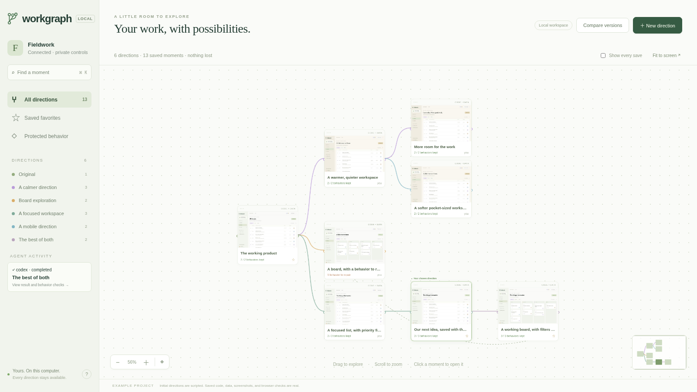

<p align="center"></p>

# Workgraph

**Explore freely. Keep what works.**

Your agent builds three directions. You like the board from one, the filter from
another, and the way comments worked before either. Workgraph gives those moments
a home: a visual tree of saved products you can recognize, open, branch, and keep
working on.

[Watch the 70-second launch film](https://github.com/aliiqbal24/workgraph/releases/download/v2.0.0/workgraph-launch-v4.mp4)



- **See what a moment looked like.** Real desktop and phone screenshots, a gallery,
  and recorded browser checks belong to the exact saved state.
- **Go back with your data.** Versions can include SQLite development databases,
  including committed WAL rows. Branches restore separate copies.
- **Keep the behavior you love.** Record an interaction, reload, and select the
  text that should remain. Future branches inherit that protected expectation.
- **Borrow a feature.** Compare two moments and describe what to bring across.
  Your agent adapts it in a new branch; checks replay independently afterward.
- **Continue with your agent.** Hermes, Codex, and Claude Code receive saved source,
  data, decisions, and next steps. The existing conversation stays open.
- **Come back tomorrow.** One local project controller keeps tasks running after
  you close the browser. Reopening restores your selected moment and canvas.

This is version 2.0, a local Linux developer preview. Git stores source underneath.
The canvas is the everyday interface; exact dependencies and checked Git acceptance
remain available in the engineering view at `/engineering`.

## Install the published release

[Download Workgraph 2.0](https://github.com/aliiqbal24/workgraph/releases/tag/v2.0.0).
The release contains the Python wheel, Hermes/Codex/Claude plugin packages,
checksums, and the narrated walkthrough. The core works without model credentials;
agent tasks use your existing runtime sign-in.

To install the native Hermes plugin directly:

```bash
hermes plugins install aliiqbal24/workgraph --ref 37c7280a514d3fa23e7193f44b5123d1f9c90163
hermes plugins enable workgraph
```

This pins the tested 2.0.0 source. Install the browser-enabled CLI below for actual
app screenshots and recordings.

## Try it locally

Requires Python 3.11+, Git 2.43+, Linux with working bubblewrap, and Chromium.
Use an already installed Chromium or set `WORKGRAPH_CHROMIUM` to its executable.
The core is standard-library Python; browser galleries and recordings use the
optional Playwright and Pillow dependencies. No Workgraph account or model key.

From this checkout:

```bash
python3 -m venv ~/.local/share/workgraph/runtime
~/.local/share/workgraph/runtime/bin/pip install '.[browser]'
~/.local/share/workgraph/runtime/bin/python -m playwright install ffmpeg
~/.local/share/workgraph/runtime/bin/workgraph showcase
```

Or install with `uv tool install '.[browser]'` to put `workgraph` on your PATH.
`workgraph showcase` creates a real full-stack Fieldwork issue tracker with saved
visual directions and a deliberate comment-persistence regression. Initial edits
are scripted; snapshots, live apps, screenshots, recordings, and checks are real.

In your own Git project:

```bash
workgraph open
```

Save the starting point. Static built pages preview immediately. For a server app,
open a saved moment and choose **Connect app** to approve its command, preparation,
readiness route, and optional SQLite development databases. Database paths live
under `.workgraph-data/`, separate from tracked source. Recipes are operator-owned;
changing one creates a new connected version. Earlier versions retain their recipe.

## Use it in your agent

**Hermes:** install the native plugin from this directory, enable it, and ask
“Open Workgraph for `/absolute/project/path`.” The native adapter uses public hooks
and middleware to capture supported foreground file and terminal operations in an
attached workspace. It does not override built-in tools.

```bash
hermes plugins install /absolute/path/to/workgraph
hermes plugins enable workgraph
```

**Claude Code:** load the checkout with `claude --plugin-dir /absolute/path/to/workgraph`.
Install the Claude Code plugin from our public marketplace:

```text
/plugin install workgraph --marketplace aliiqbal24/workgraph
```

**Codex:** install the portable package containing root `plugin.json`, `mcp.json`,
and `skills/`, or attach MCP directly:

```bash
codex mcp add workgraph -- python3 /absolute/path/to/workgraph/adapters/mcp_entry.py
```

The agent uses `workspace` to open the tree. This does not create an attempt or
change its conversation. The tool returns a viewing link; operator editing controls
open privately in the local browser. “Continue from here” starts a focused task in
an exact saved state and puts its result back on the tree. Existing runtime sign-in
and permissions govern model execution. Only run tasks with a runtime you have
already configured normally.

Codex and Claude managed launches provide MCP and final capture. Optional reviewed
lifecycle hooks add intermediate capture; they are omitted from public portable
packages. The shared tool does not configure checks, approve flows, or publish work.

## What is saved, and what isn’t

Source, explicit context, approved app recipes, configured SQLite development
snapshots, and actual browser evidence are saved in the repository's common Git
metadata. Password fields are excluded from flow recording. Use fictional or
non-secret development data: screenshots and other recorded inputs are retained.
Production databases, hosted service state, credentials, process memory, and hidden
conversation state are not restored. SQLite histories are never automatically
merged. Borrowing a feature adapts code into the target's existing data state.

App previews run disposable source/data copies inside bubblewrap with a small
filesystem view and a sanitized environment. They share the host network; this is
not a hostile-code VM or network isolation boundary. Previews have separate browser
origins and ticketed routes. Operator actions require a separate capability, strict
Host checks, and same-origin requests. Opening the UI is loopback-only.

The controller runs in the background until stopped or the machine restarts.
Pending captures recover on reopen. Abruptly interrupted agent tasks retain their
workspace and require explicit continuation. Existing agents make their own normal
provider calls. App preparation can make network requests when approved. Workgraph
has no telemetry, cloud sync, self-updater, stored model credentials, or bundled
executables. Install browser dependencies through their official packages.

## Build and verify

```bash
python -m unittest discover -s tests -v
python -m workgraph demo --complete
python scripts/package_release.py --output /tmp/workgraph-release
```

[The user journey](docs/agent-experience.md) explains launch, browsing, task capture,
and reopen semantics. [Publication](docs/publication.md) has channel-specific
packages and the remaining public-release steps. [Verification](docs/verification-v2.md)
records what was actually tested. [Engineering architecture](docs/ideal-version-control.md)
explains the underlying source and acceptance model.

MIT licensed. [Source](https://github.com/aliiqbal24/workgraph) ·
[Releases](https://github.com/aliiqbal24/workgraph/releases).
The Hermes catalog listing is reviewed separately; direct installation works before
catalog acceptance.

## Keep developing after publication

The `v2.0.0` release stays fixed for installation and reproducible demos. Development
continues on `main`; experimental work can use feature branches or separate worktrees.
Local editing does not change an installed release. Bump the version and cut a new
release when an improvement is ready. Hermes catalog updates use a new exact commit
pin through review; there is no plugin self-updater.

See [live testing](docs/live-testing.md) for using the installed plugin with your own
agent and a disposable project.
