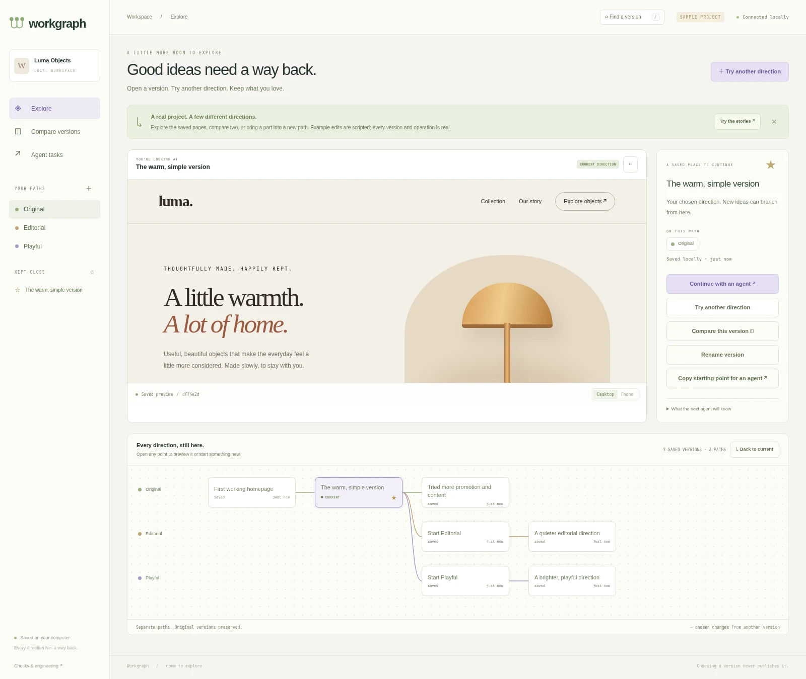
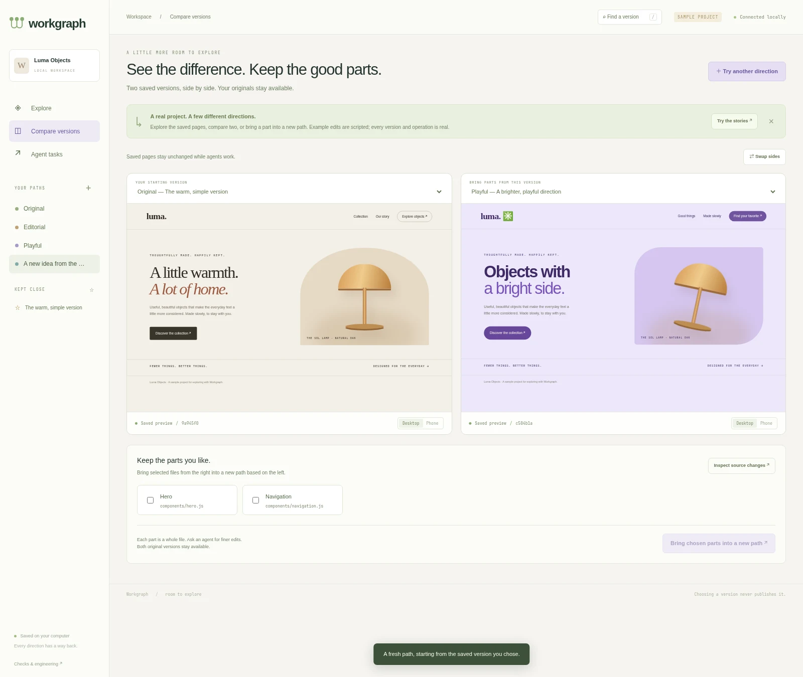
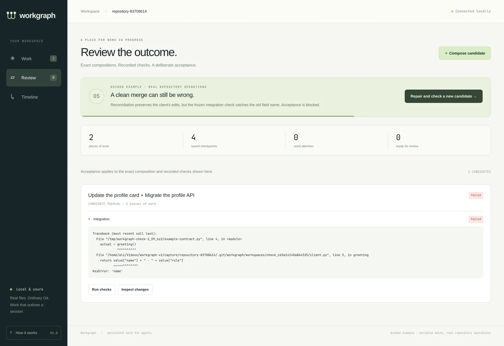

# Workgraph

**Keep every direction. Find your way back.**

Workgraph is a visual workspace for exploring projects with agents. Open a saved
version, branch from any point, compare actual pages, bring chosen changes into a
new direction, and continue with your preferred agent. Earlier versions remain
available. Git stores the source underneath.

Version 1.1 centers the five [exploration stories](docs/exploration-stories.md).
The original persistent-work engine, exact dependencies, independent checks and
Git-compatible acceptance remain available in the engineering workspace.

V1 includes a native **Hermes plugin**, a shared **MCP tool** for Codex and Claude
Code, optional lifecycle hooks, a CLI, and a private visual workspace. It has no
LLM API dependency, cloud account, telemetry, or owned credentials.



## Try the visual playground

Requirements: Linux, Python 3.11+, Git 2.43+, and working `bubblewrap` (`bwrap`).
The default check and managed terminal modes fail closed when their sandbox is
unavailable. This release is tested on Linux; Windows is not supported.

```bash
python -m venv /path/to/workgraph-env
/path/to/workgraph-env/bin/pip install .
/path/to/workgraph-env/bin/workgraph playground
```

Open the private localhost URL. The sample is a real, offline website with warm,
editorial, playful, and busier saved versions. Its initial edits are scripted and
disclosed; your branching, choices, combinations and agent tasks are real.

- Open a point in the history to inspect its saved page. Star and rename versions
  you want to find again. **Make current** chooses a direction without overwriting
  files or publishing it. That exact choice stays fixed while agents explore;
  choosing an agent's newer result is a separate, deliberate step.
- **Try another direction** creates one or more fresh paths from that exact point.
  Choose a runtime and instruction to start actual local agent tasks, or create
  paths without running a model.
- **Compare versions** opens saved pages side by side. Bring explicitly selected
  files from the right into a new path based on the left; both originals survive.
- **Download this version** exports the chosen saved files as a portable ZIP,
  without Git metadata or symbolic links. Downloads are limited to 100 MB and
  10,000 regular files. The original checkout stays intact.
- **Continue with an agent** supplies the chosen source and explicit saved notes.
  At a path's latest point, the next worker can continue the same named path in a
  fresh workspace. Continuing an earlier point creates a new direction. The
  predecessor's saved versions remain available.
  Runs use the runtime's existing authentication and normal permissions. Up to two
  run at once, with six running/queued tasks maximum. Output, errors, and Stop are
  available in **Agent tasks**. Finished output still needs review.

Previews serve immutable regular files on a separate loopback origin in an opaque
browser sandbox. Static projects with index.html (including dist/public/web
entries) work without installing dependencies or starting app processes. Arbitrary
framework servers, databases, and external services are not launched. Other
projects retain saved files, history, comparison, branching and agent continuation.
Browser sandboxing is not a hostile-code VM or a guarantee against every form of
network navigation. Individual preview/transfer files are limited to 4 MB; a
selected-file transfer is limited to 20 MB.



For a terminal-only run of the earlier engineering example:

```bash
python -m workgraph demo --complete
python -m unittest discover -s tests -v
```

## Use an existing repository

The repository needs an initial Git commit.

```bash
workgraph --repo /path/to/project init
workgraph --repo /path/to/project serve
```

In the visual workspace, **Save a starting point** captures the current tracked
and non-ignored working files without changing the original checkout/index.
**Checks & engineering** opens the detailed candidate/acceptance dashboard.

For direct CLI work, `begin` returns an isolated workspace. Edit there. `snapshot` saves source and
explicit context; native Hermes also checkpoints managed foreground operations
automatically. The original checkout and staging index are preserved.

```bash
workgraph --repo /path/to/project begin 'Migrate the profile API' --runtime hermes
workgraph --repo /path/to/project snapshot ATTEMPT_ID 'API response prepared' \
  --next 'Update the client' --decision 'Migrate API and client together' \
  --question 'Which clients still use the old field?'
workgraph --repo /path/to/project begin 'Update the client' --depends-on REVISION_ID
workgraph --repo /path/to/project takeover ATTEMPT_ID --session replacement --runtime codex
workgraph --repo /path/to/project reconcile DEPENDENT_ATTEMPT_ID
workgraph --repo /path/to/project compose REVISION_ID
```

Dependencies pin exact revisions. When a selected dependency advances, dependent
attempts become visibly outdated. Reconciliation creates a new workspace and
preserves the old attempt; it can merge text while leaving behavior to repair.



## Hermes

Install from the plugin repository, then launch an attached attempt:

```bash
hermes plugins install OWNER/REPOSITORY --enable
workgraph --repo /path/to/project launch hermes --intent 'Migrate the profile API'
```

For local development after committing the plugin source:

```bash
hermes plugins doctor /absolute/path/to/workgraph --ci
hermes plugins install file:///absolute/path/to/workgraph --enable
```

The native integration uses public tools, request/execution middleware, and
lifecycle hooks. It routes file paths and foreground terminal commands into the
active attempt, isolates terminal writes with bubblewrap, captures completed
operations, and injects explicitly labeled saved state. Repeated tool IDs are
deduplicated before execution. Uncertain operations are never blindly repeated.

The shared agent tool also exposes `history`, `version`, `compare`, `branch`, and
`combine`, so an agent can inspect saved context/source and start from the exact
point chosen in the interface. File combinations are explicit file replacements
or deletions; semantic feature merging remains an engineering task.

V1 managed attempts require foreground terminal commands. `execute_code` and the
V4A patch form are blocked with instructions to use managed terminal or the
path/old_string/new_string patch form. Unbound Hermes sessions are unaffected.
`workgraph:workgraph` is an optional bundled skill.

## Codex and Claude Code

Both runtimes use the same repository, work IDs, exact dependencies, and MCP tool:

```bash
workgraph --repo /path/to/project launch codex --attempt ATTEMPT_ID
workgraph --repo /path/to/project launch claude --attempt ATTEMPT_ID
```

The launcher uses each runtime's existing authentication. It never reads, copies,
or refreshes their credential stores. Codex/Claude launchers provide MCP and a
final checkpoint. Optional trusted lifecycle hooks add capture at tool and
compaction boundaries:

```bash
workgraph hook-config codex
workgraph hook-config claude
```

Review and install the printed configuration using the runtime's normal hook
trust process. Workgraph never bypasses hook trust or host approvals. Hooks are
local integrations; coverage differs across runtimes and hosted tools. See
[agent integration](docs/agent-integration.md).

## Checks and acceptance

Checks are configured by the operator, outside the agent tool. A candidate needs
current passing required checks before it can be accepted.

```bash
workgraph --repo /path/to/project set-check test -- python -m unittest
workgraph --repo /path/to/project verify CANDIDATE_ID test
workgraph --repo /path/to/project land CANDIDATE_ID
```

For an independent frozen check, include files copied into the check definition:

```bash
workgraph --repo /path/to/project set-check integration \
  --trusted-file /path/to/contract.py -- python '{check_root}/contract.py'
```

The check runs in a disposable workspace with a sanitized environment, read-only
host filesystem, private network, and timeout. The frozen files cannot be changed
by the implementation attempt. A successful process that changes candidate
source is rejected. Existing CI commands can be used, but checks inside the
candidate remain part of the code under review; they are not magically independent.

Evidence identifies the exact composition, code tree, check definition, and
local runner identity. Acceptance uses an atomic Git ref update and durable
publication journal, and retains the evidence used for that decision. Later
check results cannot rewrite the historical acceptance basis.

Accepted code lands on `workgraph/accepted` as one conventional commit. That
branch must not be checked out. Your current branch and staging index are not
reset. Integrate the accepted branch through your normal review/release workflow.

## Reliability and recovery

```bash
workgraph --repo /path/to/project doctor
workgraph --repo /path/to/project recover
```

Public mutations accept request IDs where appropriate. A completed request can
be replayed without creating another logical action. Publication recovery handles
interruption before or after Git's compare-and-swap. Takeover creates a new
workspace and prevents the old attempt from publishing new checkpoints. An old
worker's late file writes stay in its old copy.

Non-publication operations interrupted before acknowledgement may leave an
unacknowledged operation or orphaned managed workspace. Recovery reports these
without rerunning side effects or deleting files. A saved checkpoint remains
available independently of the original session.

Agent task metadata and output are stored locally under the common Git directory.
Stopping a task captures remaining files when possible. After an unclean UI-server
restart, prior attempts are fenced from new checkpoints and reported interrupted;
a prior runtime process may still remain in its old workspace. A second app server
can inspect the project but cannot take over another server's task controller.

The MCP connection separates a read-only `workgraph_read` tool from the normal
mutation tool. Codex can inspect saved work without granting write-tool approval;
mutation calls retain normal host approval, and the launcher captures final source
on exit. The MCP server is required at startup and uses an absolute package entry
so runtime environment filtering cannot silently remove it.

## Scope and disclosures

- Runtime data and managed workspaces live under the common Git directory in
  `workgraph/`; source trees and checkpoints are pinned under `refs/workgraph/*`.
- Source, explicit context, check output, event metadata, and retry receipts are
  stored locally. Retry receipts do not retain original terminal output.
- The plugin reads and writes the selected repository and its managed workspaces,
  runs Git and approved terminal/check commands, and may start a localhost UI.
- No product data is uploaded. No telemetry or analytics are sent.
- Restoring work restores captured code and explicit notes, not a model's hidden
  state, running processes, external services, ignored files, or secrets.
- Dependency detection is exact for recorded revisions. It does not infer every
  semantic relationship. Passing checks establish only what those checks cover.
- Local runner identity and lockfiles are captured; full hermetic reproducibility
  of arbitrary third-party dependencies is outside V1.
- Workgraph is a local cooperative tool, not an authorization system against a
  hostile process with the user's full filesystem rights. Its managed Linux
  execution paths narrow writes; they do not replace a VM or production IAM.
- An operator can set `WORKGRAPH_UNSAFE_LOCAL=1` for explicitly cooperative local
  experiments without bubblewrap. This mode is recorded as unsafe and is not the
  default or the submitted demonstration mode.
- Pre-V1 experimental stores are refused rather than silently migrated or reset.

See [V1 scope](docs/v1-scope.md), [design research](docs/ideal-version-control.md),
and [verification](docs/verification.md). MIT licensed.
